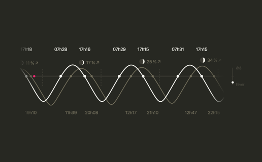
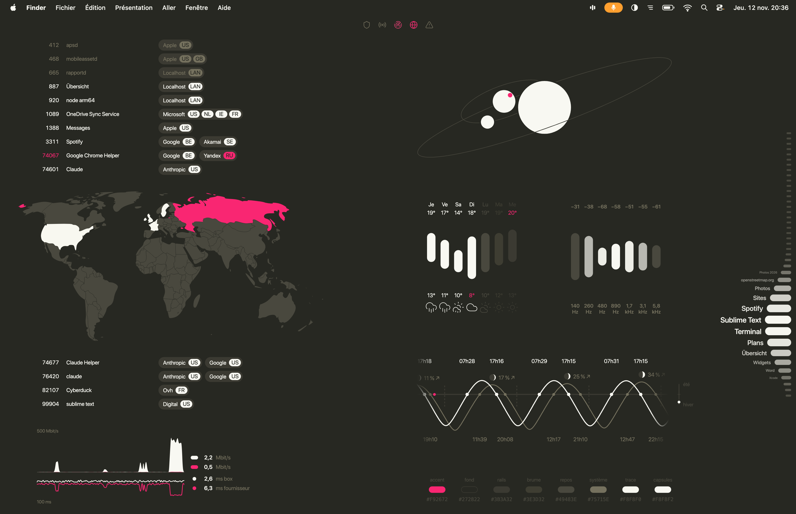

# Capsules – Soleil & Lune

La hauteur du Soleil et de la Lune sur les trois prochains jours, sur une fenêtre qui glisse avec le temps :
heures de lever et de coucher, phase de la Lune, et une petite aiguille entre l'hiver et l'été.

Un widget pour [Übersicht](https://tracesof.net/uebersicht/), gratuit, pour macOS.



Il fait partie de **Capsules**, mon bureau : une composition de widgets et d'applications en capsules, sur fond anthracite.
Tout le bureau, l'animation et les autres widgets : **[fafag.fr › Capsules › Soleil & Lune](https://fafag.fr/?capsules/soleil-lune)**



## Installation

1. Installer [Übersicht](https://tracesof.net/uebersicht/).
2. Télécharger `capsules-soleil-lune.widget.zip` et le décompresser.
3. Placer le dossier `capsules-soleil-lune.widget` dans le dossier des widgets (Übersicht → Open Widgets Folder).

Le widget s'affiche en haut à gauche de l'écran, réglé pour Paris. Il tient en un seul fichier JavaScript : aucun script ni aucune commande à installer à côté.

## Comment ça marche

- Les positions du Soleil et de la Lune se calculent dans le widget, sans connexion (formules de SunCalc).
- La courbe blanche est le Soleil, la grise la Lune ; la ligne du milieu est l'horizon.
- Les marées, facultatives et masquées par défaut, viennent d'[Open-Meteo Marine](https://open-meteo.com).

## Réglages

Tout se règle en haut de `soleil-lune.jsx`, dans `MES_REGLAGES`. Les valeurs complètes sont juste en dessous, dans `DEFAUTS` ; une clé absente ou mal écrite garde sa valeur par défaut.

- Votre ville : `lieu: { latitude: 48.8566, longitude: 2.3522 }` (en degrés ; nord et est positifs).
- La position : `general: { top: 20, left: 20 }` (en points depuis le coin haut gauche) et la largeur : `general: { largeur: 588 }`.
- La durée affichée : `fenetre: { heures: 72 }`.
- Les marées : `marees: { afficher: true }` (pour un lieu au bord de la mer).
- Les couleurs et épaisseurs : `soleil`, `lune`, `horizon`, `heures`.

Exemple pour Lyon, plus bas sur l'écran :

```js
const MES_REGLAGES = {
	general: { top: 400, left: 20, largeur: 588 },
	lieu: { latitude: 45.764, longitude: 4.8357 },
	// … le reste des réglages
};
```

Police : SF Pro Rounded si elle est installée, sinon la police arrondie du système.

## Crédits

- Calculs astronomiques : formules de [SunCalc](https://github.com/mourner/suncalc), © Vladimir Agafonkin, licence BSD 2-Clause.
- Marées : [Open-Meteo](https://open-meteo.com), gratuit pour un usage non commercial.

---

**In English** – A widget for Übersicht: the height of the Sun and the Moon over the next three days, on a sliding window – rise and set times, Moon phase, and a needle between winter and summer. Everything is computed locally (SunCalc formulas); optional tides come from Open-Meteo. Set your city at the top of `soleil-lune.jsx` (`lieu: { latitude, longitude }`, comments in French). More on [fafag.fr](https://fafag.fr/?capsules/soleil-lune).

Licence MIT – Fafa, [fafag.fr](https://fafag.fr)
